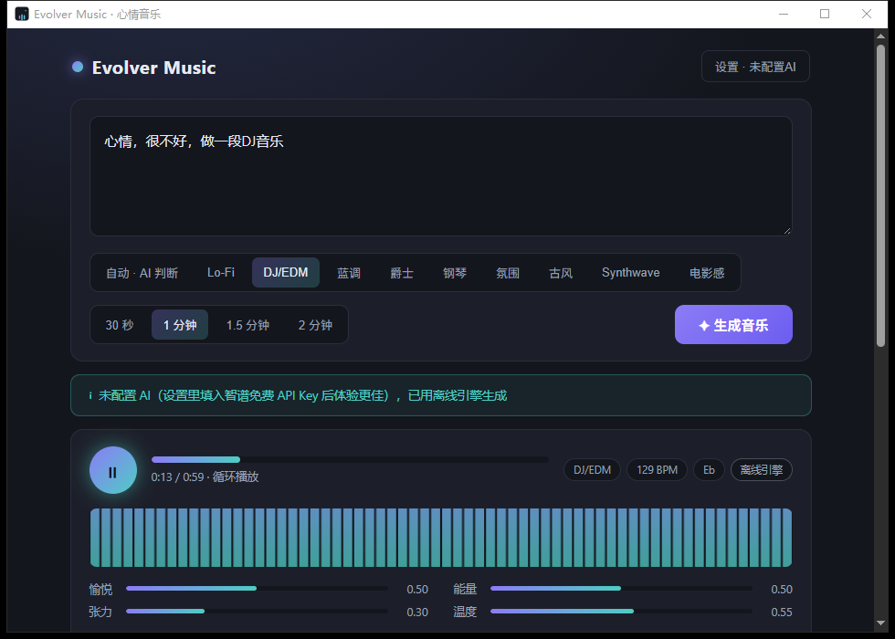
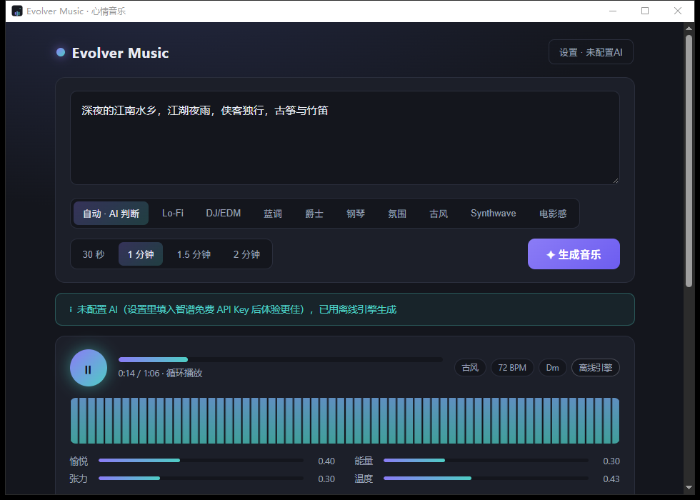

# Evolver Music · 心情音乐

> 把此刻的心情，谱成一段属于你的音乐。
> Turn the mood of this moment into music of your own.

输入几个词、一句话，甚至一整段文字，Evolver Music 会分析其中的情绪，实时生成一段贴合心境的原创器乐——支持 9 种风格、循环试听、参数微调、导出 WAV/MP3，并自动把每次生成归档成"心情日记"。

桌面应用基于 **Wails + Go**，单文件约 25MB；AI 部分使用**智谱 GLM Flash 免费模型**，也可以完全离线使用。





---

## ✨ 功能特性

- **心情 → 音乐**：任意长度的中文/英文心情文本，AI 提取"愉悦度 / 能量 / 张力 / 温暖度"四维情绪，映射为调性、速度、和弦进行与段落结构
- **9 种风格**：Lo-Fi、DJ/EDM、蓝调（12 小节）、爵士（摇摆 + 行走贝斯）、钢琴独奏、氛围、古风（五声音阶 + 古筝/竹笛）、Synthwave、电影感；也可以选"自动"，由 AI 判断（文本中写"蓝调""古风"等关键词会直接命中对应风格）
- **零成本 AI**：默认调用智谱开放平台 GLM Flash（免费额度），一次生成仅 1~2K token；不配置 API Key 也可用内置**离线情感词典引擎**，断网永远可用
- **实时合成 + SoundFont**：Tone.js 合成引擎 + 5 件打包内置的开源 SoundFont 乐器（三角钢琴、弦乐、古筝、管风琴、原声贝斯），加载失败自动回退合成器音色
- **参数微调**：能量偏置、速度缩放两个滑杆实时重编译；"🎲 换个旋律"只换种子不换和声结构
- **导出**：离线渲染导出 WAV / MP3，与试听同一套渲染图，所听即所得
- **心情日记**：历史按日期分组，带情绪色带，可收藏、回放、删除——回放是确定性重编译，不占磁盘
- **频谱可视化**：播放时实时 FFT 频谱

## 🎼 工作原理

```
心情文本 + 风格 + 时长
        │
        ▼
┌───────────────────────┐   AI（GLM Flash 免费模型，Go 后端直调，无 CORS）
│ 心情四维 → 作曲规格 JSON │   失败/无Key/断网 → 离线情感词典引擎（纯 Go）
└───────────────────────┘
        │  规格：调号/BPM/和弦进行/段落/乐层/混音（zod + Go 双侧校验）
        ▼
┌───────────────────────┐
│ 编译器（确定性，种子化）  │   规格 → 音符事件：织体/旋律游走/贝斯/鼓组/氛围
└───────────────────────┘
        │
        ▼
┌───────────────────────┐
│ Tone.js + SoundFont    │   实时播放（AudioContext）= 离线导出（OfflineAudioContext）
└───────────────────────┘
```

风格即约束模板：每种风格定义了 BPM 区间、和弦质量白名单、节奏型与乐层枚举，AI（或离线引擎）只能在模板内"填空"，从根上保证生成结果可听。

## 📦 安装与使用

从 [Releases](../../releases) 下载：

- `evolver-music-amd64-installer.exe` — Windows 安装包（NSIS，约 15MB）
- `evolver-music.exe` — 免安装便携版（约 25MB，双击即用）

首次启动可选择：

1. **配置 AI（推荐）**：在 [bigmodel.cn](https://bigmodel.cn) 注册（免费）→ 控制台创建 API Key → 粘贴到设置里，之后由 GLM Flash 作曲
2. **先离线体验**：直接使用内置离线引擎，随时可在设置中补填 Key

> 需要 Windows 10/11（依赖系统 WebView2，绝大多数机器已内置）。

## 🛠 从源码构建

```bash
# 依赖：Go 1.24+、Node 20+、Wails CLI、WebView2 Runtime
wails doctor          # 检查环境
wails dev             # 开发模式（热重载）
wails build           # 产出单文件 exe
wails build -nsis     # 同时产出 NSIS 安装包

# 测试
go test ./...                      # Go：schema 校验 / 降级引擎 / 历史存储
cd frontend && npm test            # 前端：编译器 / WAV 编码器（vitest）
```

## 🧱 技术栈

| 层 | 技术 |
| --- | --- |
| 桌面壳 | [Wails v2](https://wails.io) + Go 1.27（系统 WebView2，单文件交付） |
| AI | 智谱开放平台 GLM Flash 免费模型（OpenAI 兼容接口，Go `net/http` 直调；Provider 可替换） |
| 前端 | React 19 + TypeScript + Zustand 风格的轻状态 + Vite |
| 音频 | [Tone.js](https://tonejs.dev) + [smplr](https://github.com/danigb/smplr)（SoundFont）+ lamejs（MP3） |
| 音源 | [MusyngKite](https://gleitz.github.io/midi-js-soundfonts/) 开源 SoundFont 子集（5 件乐器，MIT/CC 授权随包分发） |
| 校验 | Go struct + zod 双侧对齐的音乐规格契约 |

## 📁 目录结构

```
├─ main.go / app.go          # Wails 入口与绑定（Compose/导出/设置/历史）
├─ internal/
│  ├─ schema/                # 音乐规格契约 + 校验/修复（两侧权威定义）
│  ├─ ai/                    # GLM Flash Provider + 提示词 + 离线降级引擎
│  └─ store/                 # 设置与历史（%AppData%/evolver-music）
├─ frontend/
│  ├─ src/music/             # zod schema + 风格特征 + 确定性编译器
│  ├─ src/audio/             # Tone.js 引擎 / 离线渲染 / WAV·MP3 编码
│  ├─ src/ui/                # 频谱 / 引导 / 心情日记组件
│  └─ public/soundfonts/     # 内置 SoundFont 子集
└─ docs/PLAN.md              # 设计方案
```

## 📄 许可

[MIT](LICENSE) © 2026 码禾数字 Mahe Digital

SoundFont 采样来自 [midi-js-soundfonts](https://gleitz.github.io/midi-js-soundfonts/)（MusyngKite），遵循其原授权分发。

---

# Evolver Music · Mood to Music

> Turn the mood of this moment into music of your own.

Type a few words, a sentence, or an entire journal entry. Evolver Music analyzes the emotion and generates original instrumental music that fits — across 9 styles, with loop playback, live parameter tweaks, WAV/MP3 export, and an automatic "mood diary" of everything you create.

A desktop app built on **Wails + Go** (a single ~25MB executable). The AI part uses **Zhipu GLM Flash** (free tier); the app also works fully offline.


## ✨ Features

- **Mood → music**: free-form Chinese/English text is distilled into four mood dimensions (valence / energy / tension / warmth), mapped onto key, tempo, chord progressions and song structure
- **9 styles**: Lo-Fi, DJ/EDM, Blues (12-bar), Jazz (swing + walking bass), Piano solo, Ambient, Chinese Guofeng (pentatonic, guzheng & dizi), Synthwave, Cinematic — or let the AI choose (mentioning "blues", "古风" etc. in the text locks the style directly)
- **Zero-cost AI**: calls Zhipu's free GLM Flash model (1–2K tokens per generation); without an API key it falls back to a built-in **offline sentiment-dictionary engine** — works with no network, always
- **Real-time synthesis + SoundFonts**: Tone.js engine plus 5 bundled open-source SoundFont instruments (grand piano, strings, koto, organ, acoustic bass), with automatic synth fallback
- **Live tweaks**: energy and tempo sliders recompile instantly; "🎲 reseed melody" swaps the melody while keeping the harmony
- **Export**: offline-rendered WAV / MP3 — the exact same graph you hear
- **Mood diary**: history grouped by date with mood strips; replay is deterministic recompilation (no audio files on disk)
- **Spectrum visualization**: real-time FFT while playing

## 📦 Install

Grab from [Releases](../../releases):

- `evolver-music-amd64-installer.exe` — Windows installer (NSIS, ~15MB)
- `evolver-music.exe` — portable single file (~25MB)

On first launch, either paste a free API key from [bigmodel.cn](https://bigmodel.cn) (enables AI composition via GLM Flash) or start with the offline engine.

> Requires Windows 10/11 (system WebView2, preinstalled on most machines).

## 🛠 Build from source

```bash
# Prereqs: Go 1.24+, Node 20+, Wails CLI, WebView2 Runtime
wails doctor          # verify environment
wails dev             # dev mode with hot reload
wails build           # single-file exe
wails build -nsis     # + NSIS installer

# Tests
go test ./...
cd frontend && npm test
```

## 🧱 Tech stack

| Layer | Tech |
| --- | --- |
| Shell | [Wails v2](https://wails.io) + Go 1.27 (system WebView2, single-binary delivery) |
| AI | Zhipu GLM Flash (free, OpenAI-compatible; provider swappable) |
| Frontend | React 19 + TypeScript + Vite |
| Audio | [Tone.js](https://tonejs.dev) + [smplr](https://github.com/danigb/smplr) SoundFonts + lamejs |
| Samples | [MusyngKite](https://gleitz.github.io/midi-js-soundfonts/) SoundFont subset (5 instruments) |
| Contract | Music spec validated on both sides (Go structs + zod) |

## 📄 License

[MIT](LICENSE) © 2026 码禾数字 Mahe Digital — SoundFont samples from [midi-js-soundfonts](https://gleitz.github.io/midi-js-soundfonts/) under their respective licenses.
